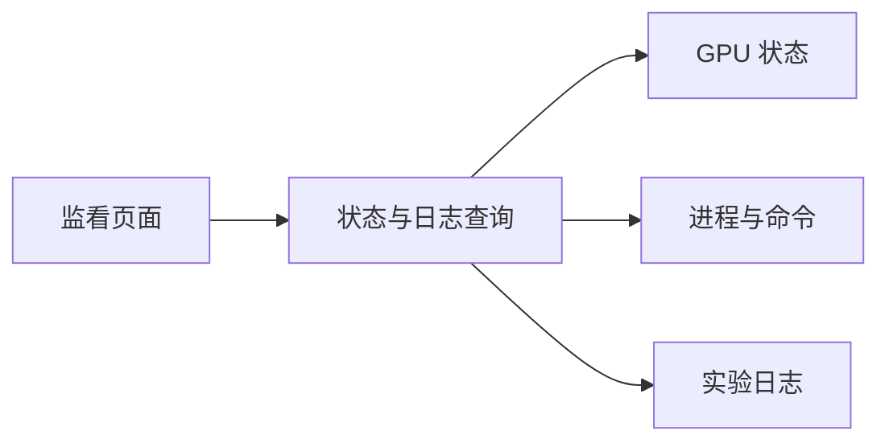

# GPU 实验监看工具

[返回项目索引](https://github.com/18538205298/project-portfolio)

## 项目概览

为远程实验提供集中查看入口，聚合 GPU 状态、运行进程、启动命令与实验日志。适合在训练和调试时快速了解任务状态。

**前端技术栈**：Vue、TypeScript、Vite。

## 功能组成

- 查看远程 GPU 状态。
- 查看运行进程及关联命令。
- 查看实验日志，辅助追踪任务进度。
- 通过统一界面减少多处切换。

## 结构示意

## 技术要点

- 页面如何组织设备、进程和日志。
- 远程查询超时和状态过期如何提示。
- 日志如何按需读取，避免一次加载大量内容。
- 连接信息和进程参数如何保护。

## 展示方式

使用演示状态和经过筛选的日志片段。服务器地址、连接凭证、完整进程命令及真实训练日志保留在运行环境中。

## 关键代码

- `samples/main.py`：来自原项目 `gpu-watch/backend/app/main.py`。
- `samples/App.vue`：来自原项目 `gpu-watch/frontend/src/App.vue`。

这些文件保留原项目中的核心逻辑，供阅读和交流。完整应用还包含其余模块、依赖与运行配置。
